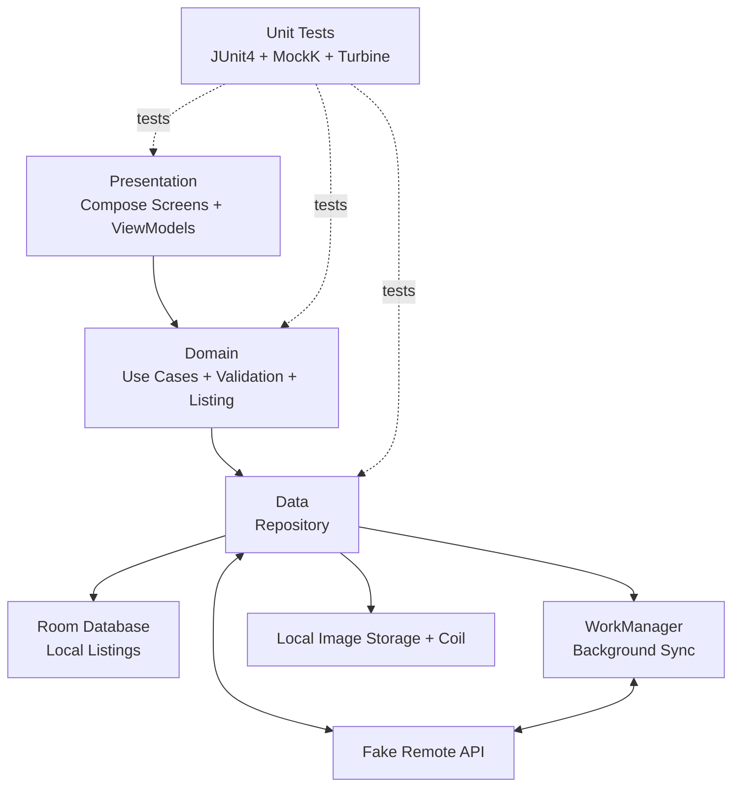
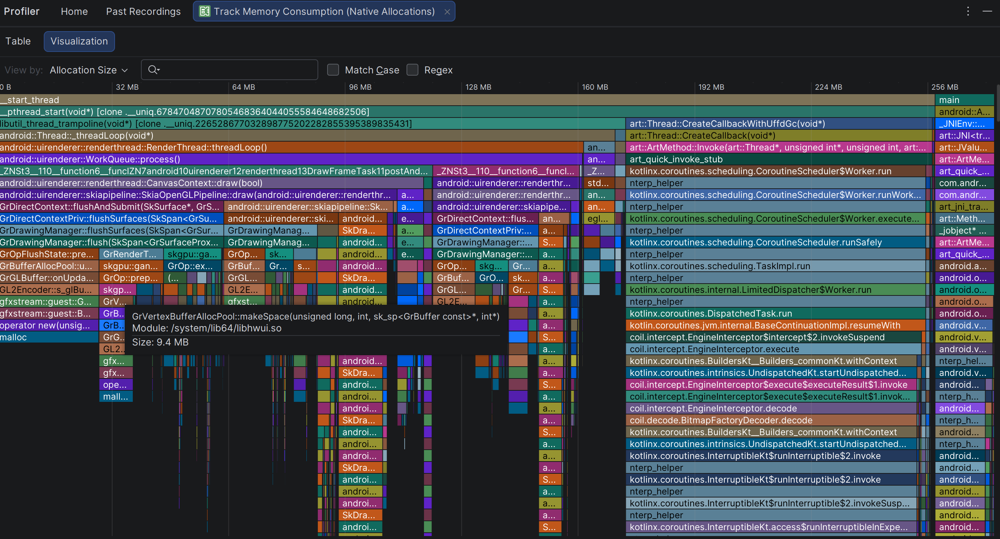
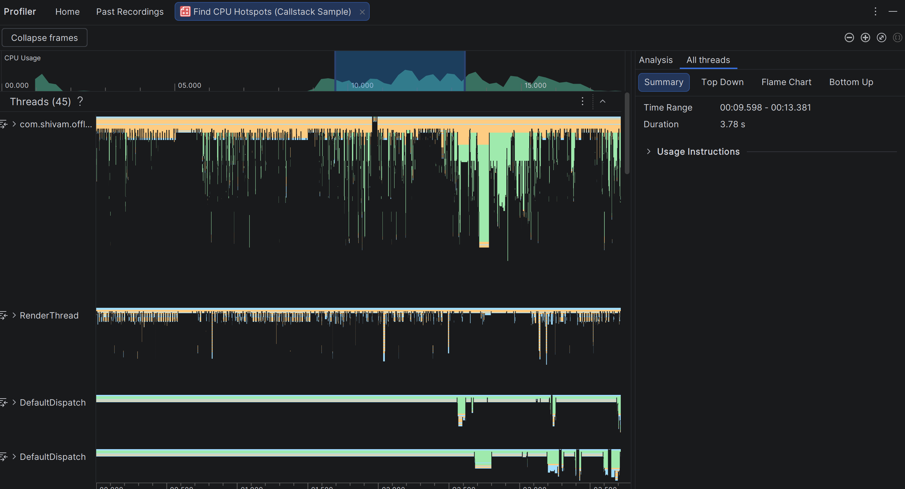

# Offline-First Marketplace App

A Kotlin Android marketplace app built with Jetpack Compose. Users can browse listings, add or edit items, and mark favorites while offline. Listings are saved locally first and can sync in the background when the device is connected to the internet.

## Demo Video

▶️ **[Watch App Walkthrough Demo (DemoVideo.mp4)](./Attachments/DemoVideo.mp4)**

*Demonstrates offline listing creation, instant optimistic local persistence in Room SQLite, WorkManager background sync, and favorite toggling with toast feedback.*

## Tech Stack

- **Kotlin** — app language
- **Jetpack Compose (Material 3)** — user interface
- **MVVM** — UI architecture
- **Room** — local database
- **Retrofit & OkHttp** — REST networking with `MockMarketplaceInterceptor`
- **WorkManager** — background sync
- **Coil** — image loading and caching
- **JUnit4, MockK, Turbine** — testing

## Architecture


The app is organized into three main layers:



### What each layer does

- **Presentation:** Shows the listings and create/edit screens. ViewModels expose UI state using `StateFlow`.
- **Domain:** Contains listing use cases, the `Listing` model, sync status, and input validation.
- **Data:** Uses a repository to connect the app to Room, local image storage, and the fake remote API.
- **Background sync:** WorkManager schedules sync work when a network connection is available.
- **Images:** Coil loads and caches listing images. Selected photos are copied to the app's private storage.
- **Tests:** Unit tests cover validation, repository behavior, and ViewModel state.

## How Offline-First Works

1. The user creates or edits a listing.
2. The app saves the listing to Room first with status `PENDING`.
3. The UI observes Room updates and shows the saved listing without waiting for the network.
4. WorkManager schedules sync work that requires a network connection.
5. The worker sends pending listings to the fake remote API.
6. After a successful sync, the listing status changes to `SYNCED`. If sync fails, the app keeps the local listing and handles the failure according to the error type.

### Sync Status

- `PENDING` — waiting to sync
- `SYNCED` — synced successfully
- `FAILED` — sync failed permanently and needs attention

## Data and Image Handling

- **Local database:** Room is the main source of listing data shown in the app.
- **Seed data:** When the database is empty on first launch, the app fetches 200 sample catalog listings from the mock REST endpoint (`GET /api/v1/listings`) via Retrofit and the OkHttp `MockMarketplaceInterceptor`, then persists them into Room SQLite for offline access. No mock seed catalog is hardcoded in the repository.
- **Conflict handling:** Uses a Last-Write-Wins strategy based on the listing's `updatedAt` timestamp.
- **Favorites:** Favorite changes are saved locally and do not trigger remote sync.
- **Images:** The Android Photo Picker lets users choose a photo. The app copies it to `filesDir/marketplace_images`.
- **Image loading:** Coil uses memory and disk caching and displays thumbnails sized at 88 × 88 dp.

## Validation

`ListingValidator` checks that:

- The title has at least 3 characters.
- The price is greater than zero.
- Required text fields are not blank.
- The category is valid.

## Testing

The project includes unit tests using JUnit4, MockK, Kotlin Coroutines Test, and Turbine.

- **`ListingValidatorTest`** — checks valid and invalid listing input.
- **`MarketplaceRepositoryImplTest`** — checks seeding, saving, favorites, and sync behavior.
- **`MarketplaceViewModelTest`** — checks listing state and save behavior.

The test suite consists of **11 unit tests** across these three test classes.

## Memory and CPU Considerations

We used Android Studio Profiler to inspect the app's CPU activity and memory allocations.

### 1. Memory Considerations

- **Image caching:** Coil is used to load and cache listing images. Thumbnails help reduce the memory needed to display images.
- **Efficient data handling:** The app uses ViewModels and lifecycle-aware state collection to manage UI data.
- **Memory analysis:** A heap dump was captured to inspect Java/Kotlin objects and identify potential memory issues.

**Heap dump results:**
- Objects: 165,981
- Classes: 7,485
- Shallow size: approximately 8.97 MiB
- Retained size: approximately 13.18 MiB
- Leak and duplicate counts reported by the profiler: 0


Native allocations were also inspected using Android Studio Profiler.



### 2. CPU Considerations

CPU profiling was performed using Android Studio's Callstack Sample recording to inspect method execution and activity across application threads.

- **Recording duration:** Approximately 17.97 seconds
- **Analysis:** Top Down call tree
- **Purpose:** Identify methods that may consume significant CPU time.



### 3. Performance Improvements to Consider

- Load appropriately sized thumbnails instead of unnecessarily large images.
- Perform database and network operations off the main thread.
- Use background synchronization for queued offline changes.
- Test scrolling and image loading with 200 listings to check responsiveness and memory usage.

**Note:** The heap dump reports Java/Kotlin heap statistics, not total application RAM usage. The profiler screenshots are observations from a particular test run, not proof of performance under every workload.

## Build and Run

### Requirements

- Android Studio Ladybug, Meerkat, or newer
- JDK 17 or newer
- Android SDK API 26 or newer

### Windows PowerShell

Run these commands from the project root:

```powershell
# Run unit tests
.\gradlew.bat testDebugUnitTest

# Build the debug APK
.\gradlew.bat assembleDebug

# Clean, build, and run unit tests
.\gradlew.bat clean assembleDebug testDebugUnitTest
```

## Project Notes

- The app uses one Gradle module, with packages separated by responsibility.
- Sync state is stored with each listing in Room rather than in a separate queue table.
- The remote API is simulated, so the app can demonstrate sync behavior without a live backend.
- The sample data contains 200 listings. Pagination is not implemented.
- Last-Write-Wins is suitable for this demo, but server-managed versions or ETags are usually safer for production systems with multiple clients.
